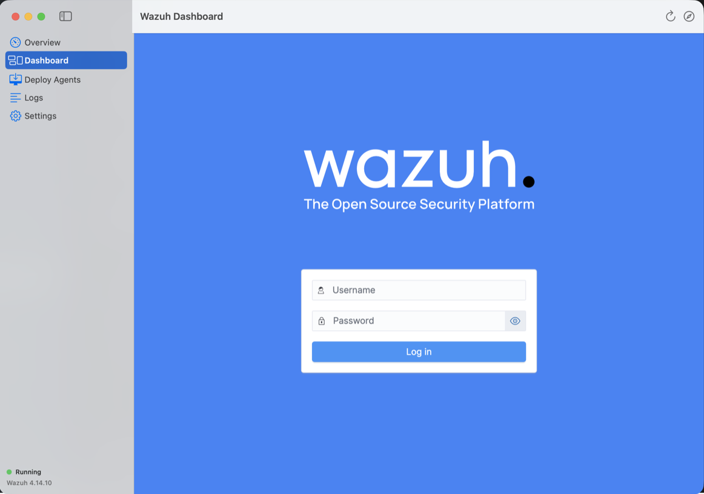
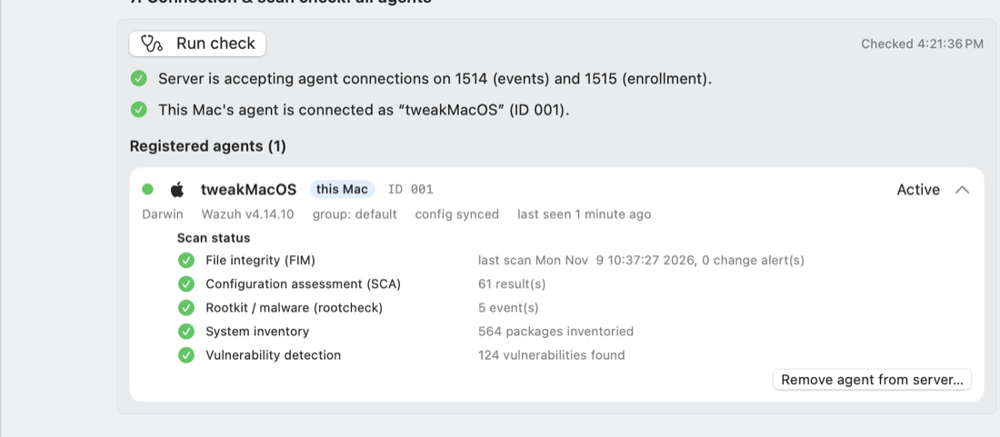

<p align="center"></p>

# Wazuh for macOS

A native macOS app that runs the complete **Wazuh 4.14.10** SIEM/XDR platform on your Mac: the **Wazuh server (manager)**, the **Wazuh indexer**, and the **Wazuh dashboard**. You control everything from one window.



> **Unofficial community packaging.** It runs the unmodified official Wazuh images from
> [wazuh/wazuh-docker](https://github.com/wazuh/wazuh-docker) (tag `v4.14.10`).
> It is not affiliated with or endorsed by Wazuh, Inc. Wazuh is licensed under GPLv2, and so is this project.

## Why Docker?

The Wazuh manager only runs on Linux, and it can't be compiled for macOS. So this app does what the official single-node deployment does: it runs the three official components as Linux containers through Docker Desktop. On Apple silicon those containers run natively as arm64 images. None of Wazuh's features are removed or changed: rules, decoders, FIM, SCA, vulnerability detection, active response, the API, agent enrollment, and the whole dashboard work exactly as upstream.

## Features

| | |
|---|---|
| **Overview** | Start, stop, and restart the stack. Shows live container state and endpoint health for the manager, indexer, and dashboard. Shows access credentials. |
| **Dashboard** | The full official Wazuh dashboard inside the app, with downloads, file uploads, and session persistence. |
| **Deploy Agents** | Install commands for macOS, Linux (DEB/RPM), and Windows agents. Also: the agent `ossec.conf` `<client>` block, a one-line command to re-point an installed agent, firewall and port rules for the server and endpoints, **one-click "enable all scans"** for every agent, endpoint verification commands for each OS, and a connection and scan check covering every agent. |
| **Logs** | Live logs for each container, plus the app's own activity log. |
| **Settings** | Stack folder, ports, and a full data reset. |
| **Menu bar** | Shield icon showing status, with quick start and stop. |

## Install

1. Install [Docker Desktop](https://www.docker.com/products/docker-desktop/) and give it at least **6 GB of memory** (8 GB recommended).
2. Download the latest `Wazuh-*-macOS-arm64.dmg` from [Releases](../../releases), open it, and drag **Wazuh** to Applications.
3. The app is ad-hoc signed, not notarized. On first launch, right-click it and choose **Open**, or run:
   ```bash
   xattr -dr com.apple.quarantine /Applications/Wazuh.app
   ```
4. Click **Start Wazuh**. On the first run the app generates TLS certificates with the official `wazuh-certs-generator` and pulls about 3 GB of images. That takes a few minutes.
5. Log in to the dashboard as `admin` / `SecretPassword`.

### Default credentials (upstream wazuh-docker defaults)

| Component | URL | User | Password |
|---|---|---|---|
| Dashboard | https://localhost | `admin` | `SecretPassword` |
| Wazuh API | https://localhost:55000 | `wazuh-wui` | `MyS3cr37P450r.*-` |
| Indexer | https://localhost:9200 | `admin` | `SecretPassword` |

Change these before exposing the stack to a network. Follow the [wazuh-docker password guide](https://documentation.wazuh.com/current/deployment-options/docker/wazuh-container.html#change-the-password-of-wazuh-users), editing the files in the stack folder.

## Enable all scans

**Deploy Agents → 5. Enable all scans** pushes one centralized `agent.conf` to an agent group (default: `default`). It has separate `<agent_config os="Darwin|Linux|Windows">` blocks, so every agent in the group gets the right settings for its OS and restarts itself within about a minute. Wazuh's `verify-agent-conf` validates the file before it's installed, and the previous version is backed up.

| Capability | macOS | Linux | Windows |
|---|---|---|---|
| File integrity monitoring | scheduled every 30 min: system binaries, `/private/etc`, LaunchAgents/Daemons, Applications, Downloads | real-time: `/etc`, binaries, `/boot`, cron, `.ssh` | real-time: hosts file, Tasks, Startup folders, Downloads, Program Files |
| Registry monitoring | — | — | Run/RunOnce, Policies, Winlogon, Services, Security |
| Rootkit & malware (rootcheck) | ✔ | ✔ | ✔ |
| CIS configuration assessment (SCA) | ✔ (adapted CIS macOS 15 benchmark for macOS 15 and later) | ✔ | ✔ |
| Inventory: hardware, OS, network, packages, ports, processes, users, groups, services, browser extensions | ✔ | ✔ | ✔ (+ hotfixes) |
| Vulnerability detection (server side, from inventory) | ✔ | ✔ | ✔ |
| Security logs | unified log (agent default), install.log | journald, auditd, auth/secure, dpkg | Sysmon, Defender, PowerShell, Task Scheduler, Firewall, System, Application |
| osquery / Docker events (optional) | osquery | osquery, Docker | osquery |

Prefer configuring a single endpoint? The same section gives a copy-paste command for each OS that appends the block to that agent's `ossec.conf` and restarts it.

**7. Connection & scan check** lists every registered agent with its OS, version, group, config sync state and last keep-alive, plus advice for Disconnected or Never-connected agents. Expand an agent to see evidence that each scan type has actually run.



## Agent not showing up?

Open **Deploy Agents → 5. Connection check**. The usual cause is an agent pointed at the wrong address, for example after DHCP changes this Mac's IP.
- Agent on the same Mac as Wazuh: use `127.0.0.1` as the server address.
- Other machines: use this Mac's Bonjour hostname (`<name>.local`), or reserve its IP on your router.
- Re-point an installed macOS agent:
  ```bash
  sudo sed -i '' 's|<address>[^<]*</address>|<address>127.0.0.1</address>|' /Library/Ossec/etc/ossec.conf && sudo /Library/Ossec/bin/wazuh-control restart
  ```
- Agents need outbound TCP 1514 and 1515 to this Mac. If the macOS firewall is on, allow `/Applications/Docker.app/Contents/MacOS/com.docker.backend`.

## Ports

`443` dashboard · `1514/tcp` agent events · `1515/tcp` enrollment · `514/udp` syslog · `55000` Wazuh API · `9200` indexer

## Where things live

- Compose stack and config: `~/Library/Application Support/WazuhMac/stack`. Edit `config/wazuh_cluster/wazuh_manager.conf` (ossec.conf) and so on, then restart the service.
- Data (alerts, agents, indexes): Docker volumes in the `wazuh-mac` compose project.
- Command-line access works too:
  ```bash
  cd ~/Library/Application\ Support/WazuhMac/stack && docker compose -p wazuh-mac ps
  ```

## Build from source

Requires the Xcode Command Line Tools (Swift 5.9+) on an Apple silicon Mac.

```bash
./scripts/build_app.sh   # -> dist/Wazuh.app
./scripts/make_dmg.sh    # -> dist/Wazuh-4.14.10-macOS-arm64.dmg
```

The project is a Swift package (`Sources/WazuhMac`, SwiftUI + WebKit). The app icon is drawn as vector geometry from `scripts/assets/logo.json`, which `scripts/fit_logo.swift` fits from `scripts/assets/logo-source.png` (straight-edge polygon plus circle, so the icon stays sharp at every size). `scripts/make_icon.swift` then renders it centered on a macOS icon tile. The bundled stack lives in `Resources/stack` and is copied verbatim from `wazuh-docker/single-node` at `v4.14.10`.

## License

GPLv2. See [LICENSE](LICENSE). Wazuh © Wazuh, Inc. The Wazuh name and logo are trademarks of Wazuh, Inc., used here only to identify the software this app packages.
